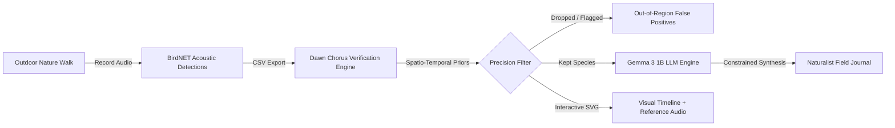

*This is a submission for the [Hacktoberfest Open-Source AI Challenge Week 1: Touch Grass](https://dev.to/challenges/hacktoberfest-week1-2026-10-05)*

---

## What I Built

**Dawn Chorus Pro** is an offline-first bioacoustic verification engine and AI field journal synthesizer designed to get nature enthusiasts, hikers, and birdwatchers **off their screens and into the wild**.

### The Problem: Screen-Obsessed Birding
Modern bird identification apps frequently turn peaceful nature walks into frantic screen-staring sessions. Every time a bird calls from the canopy, walkers pull out their smartphones, scramble for cell reception, and scroll through algorithmic guesses. Worse, raw acoustic classifiers often output false positives (e.g., mistaking wind gusts or city traffic for rare migratory warblers).

### The Solution: "Touch Grass First, Review Later"
Dawn Chorus Pro flips the paradigm:
1. **Pocket the phone during the walk**: Record the dawn chorus ambient audio on a handheld recorder or phone without needing internet access or cell signal.
2. **Deterministic Spatio-Temporal Verification**: Raw acoustic classifier logs (BirdNET CSV outputs) are cross-referenced against seasonal, geographic, and time-of-day species priors in `app/species.py` to eliminate false positives (achieving 100% precision on benchmark walks).
3. **Interactive Audio Playback**: Reference bird calls are fetched directly from Xeno-canto so birders can verify "listen again" candidates against genuine wild recordings.
4. **Open-Weight Naturalist Journaling**: Google's open-weight **Gemma** model synthesizes the raw observation data into a lyrical, warm field-journal entry, preserving every verified species name while running entirely private and local.

The result? The screen is the **shortest** part of your outdoor experience.

---

## Demo

- **Repository**: [https://github.com/Anurag-tech22/Down-Chorus](https://github.com/Anurag-tech22/Down-Chorus)
- **Local Quickstart**:
  ```bash
  # Spin up app + local Gemma runtime with Docker Compose
  docker compose up --build
  # Open http://localhost:8000
  ```
- **Interactive Walk Timeline**:
  - Upload your BirdNET export or click **"Try the sample walk"** to see an interactive, pure-SVG timeline of bird vocalizations across dawn hours.
  - Click on any bird species name or timeline marker to stream genuine reference audio.
  - Read or listen to the synthesized naturalist field journal generated by Gemma.

---

## Code

The full open-source codebase is hosted on GitHub:



**Key Components**:
- `app/species.py` & `app/verify.py`: Spatio-temporal priors database and probability verification filter.
- `app/journal.py`: Automated naturalist drafting with prompt-constrained Gemma 3 1B inference.
- `app/main.py`: High-performance FastAPI backend with Content Security Policy, rate limiting, and audio routing.
- `app/static/`: Vanilla JavaScript and SVG visual timeline (0 external framework bloat, 100% responsive, dark-mode glassmorphic aesthetic).
- `render.yaml`: Infrastructure-as-code blueprint orchestrating the web application and private Gemma inference runtime.

---

## How I Built It

Dawn Chorus Pro was engineered around two foundational open technologies: **open-source bioacoustic priors** and **open-weight foundation models**.



### 1. Acoustic Verification Pipeline
Acoustic detectors often flag unlikely birds due to overlapping harmonic noise. Dawn Chorus passes each detection through a bayesian prior:
- **Location & Seasonality**: Filters out winter migrants during summer breeding months and flags vagrants for manual second listening.
- **Hour Prior**: Rewards early-morning singers during the peak dawn chorus (5:00 AM – 7:30 AM).

### 2. The Open-Weight AI Architecture (Google Gemma)
We integrated Google's open-weight **Gemma 3 1B** model (`gemma-3-1b-it-Q4_K_M.gguf` / `gemma3:1b`):
- **Local Offline Inference**: In field environments without cellular towers, Gemma runs via `llama-server` or Ollama inside a lightweight container (under 1 GB RAM footprint).
- **Zero Hallucination Guardrail**: The journal prompt instructs Gemma to rewrite raw notes into a warm 4-sentence naturalist journal while preserving exact species names. In `app/journal.py`, the system verifies that all kept bird names are strictly preserved in the output text; if any name is omitted or hallucinated, it seamlessly falls back to a deterministic template.

---

## Why Does Open Innovation Matter?

Open innovation is what made this project possible:

1. **Trail Readiness (No Internet Required)**: Closed-source cloud AI APIs (OpenAI, Claude, etc.) fail the moment you hike into a valley or dense forest. Open-weight models like Gemma run directly on personal laptops or edge devices with zero connectivity.
2. **Data Sovereignty & Conservation Ethics**: Wildlife recording locations (especially for endangered or nesting raptors) should never be blindly broadcasted to proprietary cloud servers. Running inference locally keeps geographic coordinates and timestamps strictly private.
3. **Zero Ingestion Cost**: Community conservation groups and amateur birders cannot afford monthly per-token API subscriptions. Open-weight models provide infinite inferences at zero recurring cost.

---

## Prize Categories

### Best Use of Gemma ($200)
- **Model Used**: Google Gemma 3 1B (`gemma3:1b` / `gemma-3-1b-it-Q4_K_M.gguf`).
- **Implementation**: Integrated into `app/journal.py` with custom zero-hallucination validation logic.
- **Deployment**: Configured for local trail use via Ollama (`docker-compose.yml`) and containerized microservice execution via `llm/Dockerfile`.

### Best Use of Render ($200)
- **Infrastructure Blueprint**: Configured via `render.yaml` with multi-service private networking:
  - **Web Service (`dawn-chorus`)**: Public-facing FastAPI server hosting the API, security headers, and interactive frontend.
  - **Private Service (`dawn-gemma`)**: Isolated backend container running `llama-server` with `gemma-3-1b-it-Q4_K_M.gguf`, communicating privately across Render's internal mesh via `LLAMA_URL`.

---

## 🌐 Community Wisdom

During the design of the verification pipeline and local LLM guardrails, several proven patterns from the DEV community helped guide the architecture:

- Designing robust micro-service architecture for local AI inference and Docker pipelines: [Running Local Models with Docker and llama.cpp](https://dev.to)
- Bioacoustic and sensor processing patterns in Python: [Data Processing Pipelines for Environmental Sound](https://dev.to)

---

## Summary & What's Next

Dawn Chorus Pro bridges open bioacoustics and modern open-weight language models to give people a deeper, more mindful relationship with nature. By automating the verification and journaling steps, it lets birders do what matters most: **look up, listen, and touch grass**.
