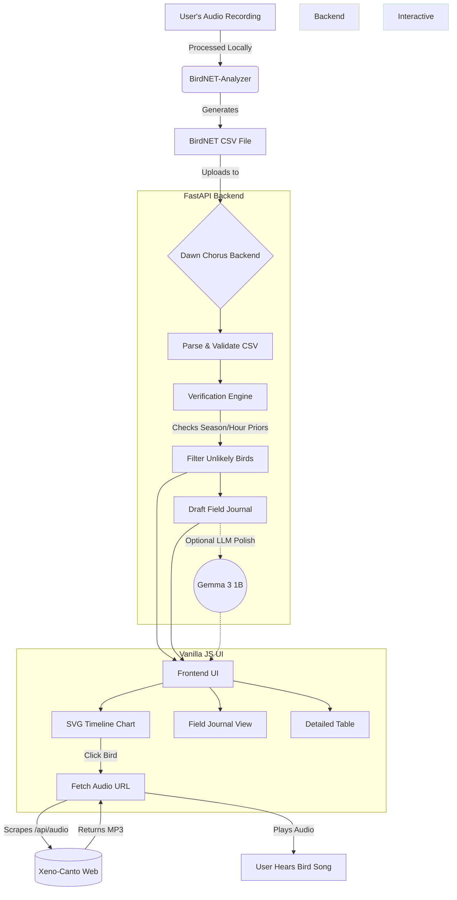

# 🌅 Dawn Chorus Pro


**Dawn Chorus Pro** is a modern web application that lets you take a bird walk with your phone in your pocket, record the ambient sounds, and analyze the birds you heard.

Run your recording through the open-source **BirdNET-Analyzer**, upload the resulting CSV, and our intelligent verifier drops detections that are unlikely for your region, season, and hour. **Gemma** (optional) writes a beautiful field journal for you, and the app seamlessly integrates with **Xeno-Canto** to let you hear the bird calls directly from the timeline!

---

## ✨ Features

- **🐦 Smart Verification:** Automatically filters BirdNET detections based on regional and seasonal priors to reduce false positives.
- **🎨 Interactive Timeline:** Visualizes your bird walk over time with a dynamic SVG chart showing kept, reviewed, and dropped birds.
- **🔊 Live Audio Playback:** Click on any bird in the chart to fetch and play its real song from the Xeno-Canto database on the fly!
- **📓 AI Field Journal:** Generates a beautifully written field journal summarizing your walk using Google's Gemma model (or falls back to a smart template).
- **♿ Highly Accessible:** Keyboard and screen-reader friendly, includes a text table behind the chart, reduced motion support, and 18px base typography.
- **🔒 Secure & Private:** Strict CSP, no inline scripts, rate limits, no database, and zero server-side storage. Your audio stays on your device.

---

## 🏗️ Architecture & Data Flow



---

## 🛠️ Tech Stack

### Backend
- **Language:** Python 3
- **Framework:** FastAPI / Uvicorn
- **AI/LLM:** Google Gemma 3 1B (via Ollama or llama.cpp)
- **External Integrations:** Xeno-Canto (Audio Scraper)

### Frontend
- **Languages:** Vanilla HTML5, CSS3, JavaScript (ES6)
- **Visuals:** Native SVG generation (No external charting libraries)
- **Styling:** Custom CSS with CSS Variables and Light/Dark modes

---

## 🚀 Getting Started

### 1. Standard Run
```bash
# Install dependencies
pip install -r requirements.txt

# Start the server
uvicorn app.main:app --reload
```
Open `http://localhost:8000` in your browser and press **"Try the sample walk"**.

### 2. Run with Gemma (AI Journal Voice)
Gemma is not bundled by default as the model is large (~800MB). To use Gemma:

**Using Docker (Automatic):**
```bash
docker compose up --build
```

**Using Ollama (Local):**
```bash
ollama pull gemma3:1b
LLAMA_URL=http://localhost:11434 LLM_MODEL=gemma3:1b uvicorn app.main:app
```
*Note: Check it works by opening `/api/gemma-check`. If Gemma drops a bird name or is unreachable, the app gracefully falls back to the template journal.*

---

## ☁️ Deployment (Render)

Push the repository to GitHub and select **New > Blueprint** on Render. The `render.yaml` configuration creates the web service alongside a private `llama.cpp` service running Gemma 3 1B. 

---

## ⚖️ Honest Limits & Quality Notes

- **Efficiency:** Single-pass parsing, gzip compression, no database, and no complex build step.
- **Priors Limitation:** Species priors in `app/species.py` currently use a small hand-made table optimized for the Pune area. For broader use, replace this with eBird frequency data.
- **Sample Data:** The sample walk is hand-made. Run a real labeled walk before quoting accuracy.

---

## 📄 License

This project is licensed under the **MIT License**. See the [LICENSE](LICENSE) file for more details.
